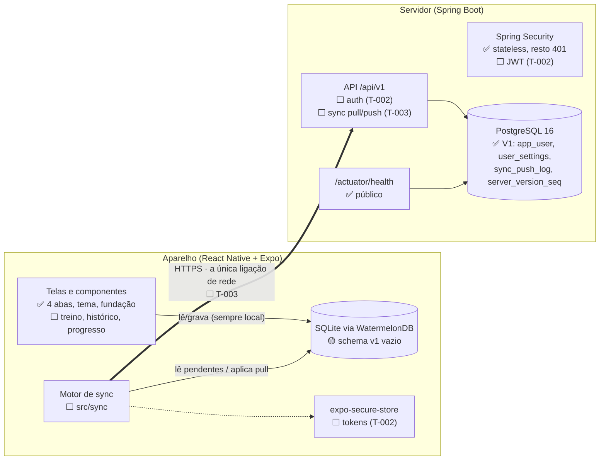
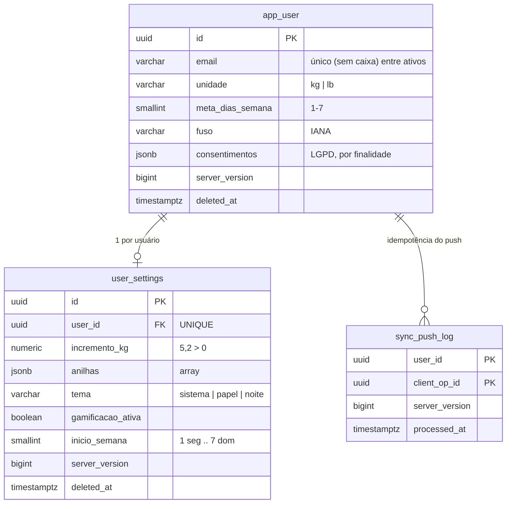

# Arquitetura

> Fonte: `docs/requisitos.txt` (seção "Arquitetura offline-first e sincronização"), `docs/adr/` e o código
> em `backend/` e `mobile/`. Atualizado no T-001 (2026-10-14).
>
> Legenda: ✅ **existe** no código · 🟡 **parcial** (esqueleto) · ⬜ **planejado** (ainda não existe)

## Princípio central

**A tela nunca fala com a API.** Ela lê e grava no SQLite do aparelho, e um motor de sync replica em
segundo plano. Salvar e finalizar um treino custa o mesmo com ou sem sinal (RN-01, RNF-01). Uma série
concluída é persistida em transação antes de a UI confirmar (RNF-02).

## Componentes



| Componente | Situação | Onde |
|------------|----------|------|
| App com 4 abas, temas Papel/Noite, fontes, i18n | ✅ | `mobile/src/` — ver [mobile.md](mobile.md) |
| Banco local WatermelonDB (SQLite, JSI) | 🟡 configurado, schema sem tabelas | `mobile/src/db/` |
| Motor de sync no app | ⬜ T-003 | `mobile/src/sync/index.ts` (só o placeholder) |
| Tokens no Keychain/Keystore | ⬜ T-002 | — |
| API Spring Boot, segurança mínima | ✅ | `backend/src/main/java/com/onemore/` — ver [backend.md](backend.md) |
| Schema do servidor (Flyway V1) | ✅ | `backend/src/main/resources/db/migration/V1__baseline.sql` |
| Endpoints `/api/v1/auth/*` | ⬜ T-002 | — |
| Endpoints `/api/v1/sync/pull` e `/push` | ⬜ T-003 | — |
| PostgreSQL de dev | ✅ | `infra/docker-compose.yml` (127.0.0.1:5433) |

## Protocolo de sync (planejado para o T-003)

O protocolo segue o pull/push do WatermelonDB ([ADR-001](../adr/ADR-001-stack-e-offline-first.md)).
O que já existe é a **base no banco**: a sequência global, o trigger e a tabela de idempotência.

```mermaid
sequenceDiagram
    participant App as App (SQLite)
    participant API as API /api/v1/sync
    participant PG as PostgreSQL

    Note over App: usuário treina offline;<br/>tudo grava local com UUID v7
    App->>API: POST /push {changes por tabela, client_op_id}
    API->>PG: transação: aplica created/updated/deleted
    Note over PG: trigger set_server_version()<br/>dá nova server_version a cada linha ✅
    API->>PG: grava (user_id, client_op_id) em sync_push_log ✅
    API-->>App: nova server_version
    App->>API: GET /pull?last_pulled_version=X
    API->>PG: linhas com server_version > X (inclui tombstones)
    API-->>App: changes por tabela + versão atual
```

- **Quando sincroniza (planejado):** ao abrir o app, ao finalizar treino, ao reconectar e em background
  (WorkManager/BGTaskScheduler); nunca bloqueando uma série.
- **Idempotência (RNF-06):** um `client_op_id` repetido é ignorado e o servidor devolve a mesma
  `server_version` da primeira aplicação (`sync_push_log`, `V1__baseline.sql:97`).
- **Conflitos (RN-21):** resolvidos no servidor. Rotinas, exercícios e perfil: last-write-wins por
  registro. Séries de treino: união por ID. Exclusão vence edição concorrente.
- **Auth offline (RF-05):** token expirado só pausa o sync, nunca o uso do app.

### Riscos conhecidos do sync (BACKLOG)

- **R-01 — ordem do `server_version`:** a versão é atribuída no INSERT/UPDATE, não no commit. Uma transação
  que pega N e comita depois de outra com N+1 pode ficar invisível para quem já puxou até N+1. Solução e
  teste concorrente são obrigatórios no T-003.
- **R-04 — autorização:** `user_id` sempre vem do token, nunca do payload; push do `app_user` só aceita
  `nome`, `unidade`, `meta_dias_semana`, `fuso`.
- **R-06 — tombstone de `user_settings`:** a unicidade por `user_id` vale mesmo com `deleted_at`, então um
  novo `user_settings` com outro id para o mesmo usuário é rejeitado. O push precisa fazer upsert por
  `user_id` ou rejeitar explicitamente.
- **R-08 — versão em todo UPDATE:** o trigger gera versão nova mesmo quando nada muda, então um push repetido
  com dados idênticos devolve o registro no pull de todos os aparelhos. Além disso, `sync_push_log` guarda uma
  só `server_version` por lote: o contrato do T-003 define qual é devolvida.
- **R-09 — `app_user` fora do padrão:** sem `user_id` nem índice de pull. O T-003 define como o pull entrega o
  perfil (filtro por `id` = usuário do token).

## Modelo de dados

Colunas de controle de toda tabela sincronizável: `id` (UUID v7 do cliente), `user_id`, `created_at`,
`updated_at` (relógio do cliente, UTC), `server_version` (servidor, sequência global), `deleted_at`
(tombstone). A exceção é `app_user`, cujo próprio `id` é o usuário.



✅ As três tabelas acima existem (V1). ⬜ Planejadas em tarefas futuras, conforme `requisitos.txt`:
`exercise`, `routine_folder`, `routine`, `routine_exercise`, `routine_set`, `workout`, `workout_exercise`,
`workout_set`, `body_measurement`. PRs, XP, nível, streak e volume semanal **não** são tabelas: são
derivados das séries e calculados localmente (RN-16).

## Decisões de arquitetura

| ADR | Decisão |
|-----|---------|
| [ADR-001](../adr/ADR-001-stack-e-offline-first.md) | Expo + dev client, WatermelonDB, Spring Boot + Java 17, PostgreSQL 16, JWT + refresh, `server_version` global e `sync_push_log` |
| [ADR-002](../adr/ADR-002-spring-boot-4.md) | Migrar o backend de Spring Boot 3.5.16 para 4.0.x na T-001b (fim do suporte OSS da 3.5) |
