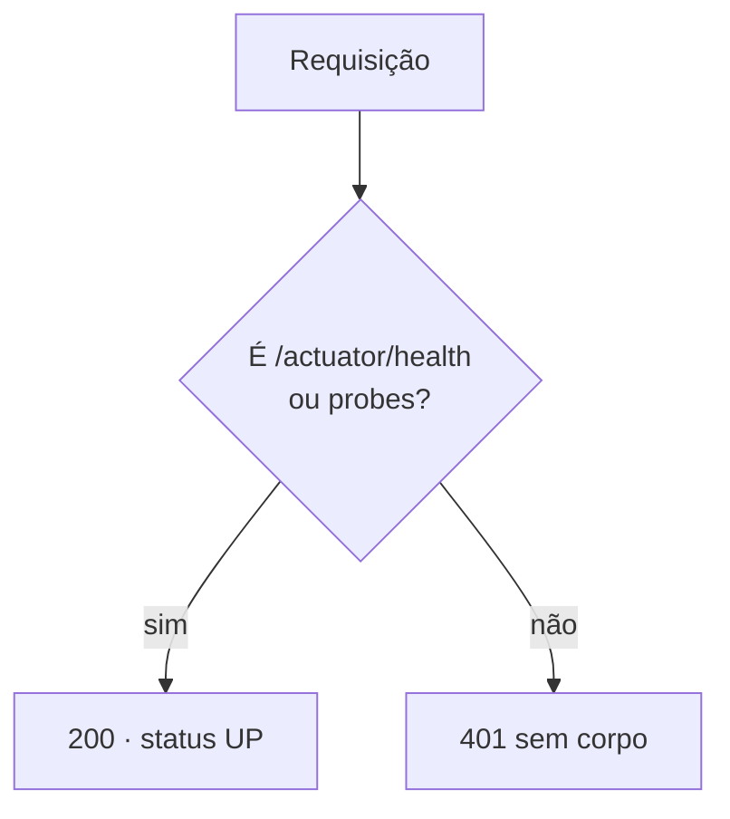

# Backend (API Spring Boot)

> Estado: **T-001 aprovado** (Dumont 53/53, Leônidas com ressalvas resolvidas, Sérgio) em 2026-10-14.
> Referência rápida do dia a dia: [`backend/README.md`](../../backend/README.md), mantido pelo Tesla.
> Este guia explica o *porquê* e onde cada coisa está.

## Stack

| Item | Valor | Onde |
|------|-------|------|
| Spring Boot | **3.5.16** (última OSS da 3.5; migração para 4.0.x na T-001b, [ADR-002](../adr/ADR-002-spring-boot-4.md)) | `backend/pom.xml:9` |
| Java | 17 | `backend/pom.xml` (`java.version`) |
| Build | Maven 3.9.16 via wrapper, com `distributionSha256Sum` | `backend/.mvn/wrapper/maven-wrapper.properties` |
| Starters | Web, Security, Data JPA, Validation, Actuator | `backend/pom.xml` |
| Banco | PostgreSQL 16 + Flyway (`flyway-database-postgresql`) | `backend/pom.xml` |
| Testes | spring-boot-starter-test, spring-security-test, Testcontainers (PostgreSQL) | `backend/pom.xml` |

## Estrutura

```
backend/
├── pom.xml                         # perfil dev ligado só no spring-boot:run (linha 94)
├── src/main/java/com/onemore/
│   ├── OneMoreApplication.java     # entrypoint; exclui UserDetailsServiceAutoConfiguration
│   └── config/SecurityConfig.java  # cadeia de segurança da Fase 0
├── src/main/resources/
│   ├── application.yml             # base: datasource só por variável, JPA validate, UTC, actuator
│   ├── application-dev.yml         # defaults locais (5433) e health com detalhes
│   └── db/migration/V1__baseline.sql
└── src/test/java/com/onemore/      # 53 testes de integração (Testcontainers)
```

Pacote base `com.onemore`. Ainda não há controllers, entidades JPA nem repositórios: o T-001 entrega só a
fundação.

## Configuração

`application.yml` (base, vale em qualquer ambiente):

- Datasource **sem default**: `${SPRING_DATASOURCE_URL}`, `_USERNAME`, `_PASSWORD`. Sem elas a app não sobe
  fora do perfil dev, o que evita uma senha padrão em produção.
- `spring.jpa.hibernate.ddl-auto: validate` (`application.yml:12`): o Hibernate nunca cria nem altera
  tabelas. O schema é só do Flyway.
- `open-in-view: false`, Hibernate e Jackson em **UTC** (`application.yml:10,16`), datas em ISO-8601.
- Erros nunca expõem stacktrace nem mensagem (`server.error.include-*: never`).
- Actuator expõe **só** `health`, sem detalhes (`show-details: never`), com probes `liveness`/`readiness`.

`application-dev.yml` (perfil `dev`, ativado só pelo `./mvnw spring-boot:run`):

- Defaults do datasource iguais ao `infra/docker-compose.yml` (`localhost:5433`, `onemore`/`onemore_dev`).
- `show-details: always` no health, para ver o estado do banco localmente.

## Segurança da Fase 0



- `SecurityConfig.java:31`: só o `HealthEndpoint` é `permitAll()`; todo o resto exige autenticação.
- Como ainda não existe mecanismo de login, **tudo fora do health responde 401** até a T-002
  (`HttpStatusEntryPoint(UNAUTHORIZED)`, `SecurityConfig.java:33`).
- API **stateless** (`SecurityConfig.java:29`): sem sessão, sem CSRF, sem form login, sem HTTP Basic, sem
  logout.
- `OneMoreApplication.java:8` exclui `UserDetailsServiceAutoConfiguration`, para o Spring não criar um
  usuário em memória com senha gerada no log.
- Postgres do compose publicado só em `127.0.0.1` (achado do Leônidas, corrigido).

Pendências de segurança registradas para as próximas tarefas (BACKLOG): R-03 (JWT fail-fast, login nunca
autentica conta em tombstone, recadastro só com e-mail verificado), R-04 (autorização no sync), R-05
(histórico de consentimento LGPD).

## Banco: migração V1

Arquivo: `src/main/resources/db/migration/V1__baseline.sql`. **Nunca altere uma migração já mergeada**;
mudanças entram em `V2__...`, `V3__...`.

| Objeto | Linha | Para quê |
|--------|-------|----------|
| `server_version_seq` | 13 | Sequência global de versões, compartilhada por todas as tabelas sincronizáveis |
| `set_server_version()` | 17 | Função de trigger: `NEW.server_version := nextval(...)` |
| `app_user` | 31 | Perfil da conta (email, nome, unidade, meta, fuso, consentimentos LGPD) |
| `ux_app_user_email_ativo` | 53 | E-mail único sem diferenciar caixa, **só entre contas ativas** |
| `user_settings` | 62 | Ajustes do usuário (incremento, anilhas, tema, gamificação, início da semana) |
| `ix_user_settings_pull` | 86 | Índice `(user_id, server_version)` para o pull |
| `sync_push_log` | 97 | Idempotência do push: PK `(user_id, client_op_id)` |

### Como a `server_version` funciona

1. Toda tabela sincronizável tem um trigger `BEFORE INSERT OR UPDATE` que chama `set_server_version()`.
2. O valor enviado pelo cliente (ou por JPA, ou por SQL manual) é **sempre sobrescrito**. Só o servidor
   numera.
3. Um tombstone (`UPDATE ... SET deleted_at = now()`) também é um UPDATE, então ganha versão nova e o pull
   entrega a exclusão.
4. A sequência é **global**: as versões de `app_user` e `user_settings` vêm da mesma série, o que permite o
   pull pedir "tudo com `server_version > X`" de uma vez.

Risco conhecido: **R-01** (a versão é atribuída na escrita, não no commit), a resolver no T-003. Ver
[arquitetura.md](arquitetura.md#riscos-conhecidos-do-sync-backlog).

### Domínios aceitos (contrato com o app)

| Tabela | Campo | Regra | Default |
|--------|-------|-------|---------|
| `app_user` | `unidade` | `kg` ou `lb` | `kg` |
| | `meta_dias_semana` | 1–7 (RN-14) | 3 |
| | `fuso` | nome IANA (ex.: `America/Sao_Paulo`) | `UTC` |
| | `consentimentos` | objeto JSON por finalidade (RN-25) | `{}` |
| `user_settings` | `incremento_kg` | `numeric(5,2)` > 0 (RN-13) | 2,50 |
| | `anilhas` | array JSON, ex.: `[{"kg":20.00,"qtd":2}]` | `[]` |
| | `tema` | `sistema`, `papel`, `noite` | `sistema` |
| | `gamificacao_ativa` | boolean (RF-64) | `true` |
| | `inicio_semana` | ISO 1 (seg) – 7 (dom) (RN-24) | 1 |

Particularidades:

- `app_user` **não tem `user_id`**: o próprio `id` é o usuário. É a única exceção à regra "toda tabela
  sincronizável tem `user_id`" do CLAUDE.md, e só existe no servidor (o app guarda cache do perfil). Como o
  pull vai entregar o perfil é definido no T-003 (R-09).
- O trigger gera versão nova em **todo** UPDATE, mesmo sem mudança de dados (R-08, T-003).
- `user_settings` tem `UNIQUE (user_id)` **mesmo com tombstone** (R-06): o push do T-003 precisa tratar isso.
- FKs para `app_user` são `ON DELETE CASCADE`: o expurgo físico de uma conta (RN-20, após 30 dias) leva
  junto os settings e o log.

### Rastreabilidade de requisitos

| Requisito | Onde está atendido |
|-----------|--------------------|
| RNF-16 (observabilidade) | Actuator com health e probes (`application.yml`); métricas de sync ⬜ T-003 |
| RNF-17 (testes, Testcontainers) | `src/test/java/com/onemore/*` |
| RNF-18 (Flyway, `/api/v1`) | `db/migration/V1__baseline.sql`; prefixo `/api/v1` ⬜ T-002 |
| RNF-06 (idempotência) | `sync_push_log` (base); lógica ⬜ T-003 |
| RN-13 (kg com 2 casas) | `incremento_kg numeric(5,2)` |
| RN-20 (exclusão lógica) | `deleted_at` em todas as tabelas, versionado pelo trigger |
| RN-24 (UTC, semana na segunda) | Hibernate/Jackson em UTC; `inicio_semana` default 1 |
| RN-25 / RNF-12 (consentimento) | `app_user.consentimentos` (estado atual; histórico ⬜ R-05) |

## Testes

Todos são de integração, com PostgreSQL real via Testcontainers (`TestcontainersConfiguration.java`,
imagem `postgres:16-alpine`, a mesma do compose). Rodar: `./mvnw test` com o Docker ligado.

| Classe | O que garante |
|--------|---------------|
| `OneMoreApplicationTests` | Contexto sobe; health público e `UP` sem detalhes; outras rotas 401 |
| `SegurancaFase0Tests` | Probes públicas; componentes do health ocultos; actuator/API 401 sem corpo; sem Basic, form login, sessão |
| `BaselineMigrationTests` | `server_version` atribuída pelo servidor e avançando; e-mail único entre ativos; 1 settings por usuário; constraints; reenvio do mesmo op id |
| `V1SchemaContratoTests` | Colunas e tipos de sync, defaults, CHECKs nos limites, insert sem `server_version`, sequência global entre tabelas, FKs, tombstones, push log |

O T-001 é isento de TDD (testes escritos depois do código). A partir do T-002, o Dumont escreve os testes de
aceite **antes** da implementação (ver CLAUDE.md).

## Próximos passos planejados

- **T-001b:** Spring Boot 4.0.x (Spring Framework 7, Security 7), mantendo Java 17 e a suíte verde.
- **T-002:** autenticação JWT (access curto + refresh), `JWT_SECRET` validado no boot (R-03).
- **T-003:** `/api/v1/sync/pull` e `/push`, com R-01, R-04 e R-06 cobertos por testes de aceite.
