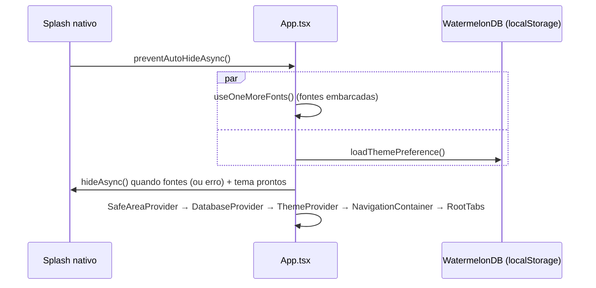

# Mobile (app React Native + Expo)

> Estado: **T-001 aprovado** em 2026-10-15: testes do Dumont (83/83), segurança do Leônidas (com ressalvas
> resolvidas) e code review do Sérgio (sem bloqueantes). Validado no emulador Android (Pixel 4a): o banco
> abre com JSI na New Architecture e o tema Noite persiste depois de reiniciar o app.
> Referência rápida: [`mobile/README.md`](../../mobile/README.md).

## Stack

| Item | Versão | Observação |
|------|--------|------------|
| Expo SDK | ~57 | managed + **dev client** (`expo-dev-client`); não roda no Expo Go |
| React Native / React | 0.86.3 / 19.2.3 | |
| TypeScript | ~6.0 | `strict: true` |
| WatermelonDB | 0.28.0 | SQLite com JSI. Plugin de config `@lovesworking/watermelondb-expo-plugin-sdk-52-plus` **1.0.3** (versão exata) no `app.json`; no iOS, `expo-build-properties` adiciona o pod `simdjson` (`ios.extraPods`) |
| Navegação | `@react-navigation/bottom-tabs` 7 | com `TabBar` próprio |
| i18n | i18next 26 + react-i18next 17 + `expo-localization` | pt-BR padrão, en |
| Fontes | `@expo-google-fonts/*` | Racing Sans One, Barlow, Barlow Condensed, IBM Plex Mono |
| Ícones | `react-native-svg` | pacote oficial de 32 ícones |
| Testes | jest-expo, React Native Testing Library (`devDependencies`) | 7 suítes, 83 testes em `mobile/__tests__/` (ver [Testes](#testes)) |
| Assets | `expo-asset` ~57 | dependência **direta** (o `expo-font` precisa dele; aninhado em `expo/node_modules`, o jest não o resolvia) |

> **Por que não o `@morrowdigital/watermelondb-expo-plugin`?** Ele quebra o build Android no RN 0.86
> (`Unresolved reference JSIModulePackage`, API da arquitetura antiga que foi removida). Não volte para ele.

Identificador: `com.onemore.app` (Android e iOS), scheme `onemore`, somente retrato (`app.json`).
`android.allowBackup: false`: o SQLite local não entra no backup do Google nem no `adb backup` (achado do
Leônidas).

## Estrutura

```
mobile/
├── index.ts                 # registerRootComponent(App)
├── app.json                 # nome, ícones, splash Papel/Noite, plugins nativos
├── eslint.config.js         # regras do Design System (ver abaixo)
└── src/
    ├── App.tsx              # splash → fontes + tema salvo → providers → navegação
    ├── navigation/RootTabs.tsx
    ├── screens/             # 4 abas (placeholders) + PlaceholderScreen
    ├── components/          # Icon, Button, IconButton, TopBar, TabBar
    ├── theme/               # theme.ts, ThemeProvider, text, fonts
    ├── db/                  # WatermelonDB: schema, migrations, preferências locais
    ├── sync/                # ⬜ motor de sync (T-003), hoje só um placeholder
    └── i18n/                # instância i18next, locales, formatação pt-BR
```

## Inicialização



- Nada na inicialização depende de rede: fontes vêm no bundle e i18n inicializa de forma síncrona
  (`src/i18n/index.ts:26`, `initAsync: false`).
- Se as fontes falharem, o app segue com a fonte do sistema (`src/App.tsx:62`). Se a leitura do tema falhar,
  usa `system` (`src/db/preferences.ts:15`).

## Navegação (RNF-08)

`src/navigation/RootTabs.tsx:19` fixa a ordem e os ícones das abas:

| Aba | Rota | Ícone | Tela |
|-----|------|-------|------|
| Treinar | `Train` (inicial) | `notebook` | `TrainScreen`: placeholder com a data no kicker ("QUA · 14 OUT") |
| Histórico | `History` | `calendar` | `HistoryScreen`: placeholder |
| Progresso | `Progress` | `chart` | `ProgressScreen`: placeholder |
| Perfil | `Profile` | `user` | `ProfileScreen`: troca de tema Sistema/Papel/Noite |

O `Tab.Navigator` usa `tabBar={AppTabBar}`, que renderiza o componente `TabBar` do Design System e emite o
evento `tabPress` do React Navigation antes de navegar.

## Tema (RF-72)

- `src/theme/theme.ts` é cópia **literal** do Guia React Native (cores `light`/`dark`, `space`, `radius`,
  `border`, `size`, `type`). Não edite valores à mão. O Guia gera esse arquivo de um `tokens.json`, que
  **ainda não está no repositório**: até ele chegar, um token novo exige copiar o arquivo do Guia de novo.
- `src/theme/ThemeProvider.tsx`: preferência `system | light | dark`. Em `system`, só vira Noite se o
  aparelho disser `dark` explicitamente; Papel é o padrão (`ThemeProvider.tsx:44`).
- `useTheme()` devolve `{ theme, colors, preference, setPreference }`.
- `src/theme/text.ts`: adapta `type` para `TextStyle` (`text.label`, `text.numMd`…), sem tocar no
  `theme.ts`.
- A preferência é salva no `localStorage` do WatermelonDB (`src/db/preferences.ts`), só no aparelho. Quando
  `user_settings` chegar ao app, ela passa a sincronizar com o mapeamento `system→sistema`, `light→papel`,
  `dark→noite` (domínio da V1 do backend).
- Splash e ícone adaptativo usam o creme Papel e o fundo Noite (`app.json`).

## Componentes (passo 1 do Guia RN)

Mesmos nomes e props do Design System. `onClick` do web vira `onPress`.

| Componente | Props principais | Comportamento e acessibilidade |
|------------|------------------|--------------------------------|
| `Icon` | `name`, `color` (obrigatória), `size=24`, `accessibilityLabel` | Cópia de `docs/1More-icones/1more-icons/Icon.tsx` (paths idênticos). Sem rótulo, é decorativo e oculto do leitor de tela |
| `Button` | `variant` (`primary`/`secondary`/`ghost`/`danger`), `size` (`md` 48 / `lg` 56), `block`, `icon`, `iconRight` | `accessibilityRole="button"`; o `accessibilityState` de quem chama é mesclado com o `disabled` (ex.: `checked` no seletor de tema); anel de foco `focus`; fundo `paperSunk` ao pressionar (no `primary`, `inkMuted`, para manter o contraste do `onInk`) |
| `IconButton` | `icon`, `label` (obrigatório), `variant` (`ghost`/`outline`), `size` | Lado nunca abaixo de 48 (`Math.max`); `label` vira `accessibilityLabel`; mescla o `accessibilityState` como o `Button` |
| `TopBar` | `title`, `kicker`, `compact`, `left`, `right` | Título com `accessibilityRole="header"`; sublinhado duplo de livro-caixa |
| `TabBar` | `items`, `active`, `onChange` | `tablist`/`tab` com `accessibilityState.selected`; barra de tinta na aba ativa; respeita a safe area |

`PlaceholderScreen` (`src/screens/PlaceholderScreen.tsx`) é o esqueleto provisório das abas e sai quando
cada tela for implementada. O seletor de tema do Perfil usa `Button` como rádio até existir o
`SegmentedControl` (passo 4 do Guia).

## Regras do Design System checadas pelo lint

`eslint.config.js`, válido para `src/**` exceto `theme.ts`:

- Proíbe cor literal (`#hex`, `rgb()`, `hsl()`).
- Proíbe `fontWeight` (no RN o peso vem do `fontFamily`).
- Proíbe `elevation`, `shadowRadius`, `shadowOpacity` (sem sombra difusa).

## Banco local (WatermelonDB)

- `src/db/index.ts`: `SQLiteAdapter` com `jsi: true`, `dbName: 'onemore'`, sem `modelClasses` ainda.
- `src/db/schema.ts`: `version: 1`, **sem tabelas**. Tabelas sincronizáveis entram nas próximas tarefas,
  sempre com `id` (UUID v7), `user_id`, `created_at`, `updated_at`, `server_version`, `deleted_at`.
- `src/db/migrations.ts`: vazio. Regra: nunca alterar um passo publicado; subir `version` e adicionar passo.
- `src/sync/index.ts`: só a regra registrada em comentário. Nenhuma tela chama a API; só este módulo falará
  com a rede (RN-01/RNF-01).

## i18n e formatação (RNF-15)

- `src/i18n/index.ts`: pt-BR é o padrão; usa inglês só se o idioma do aparelho começar com `en`.
- Chaves tipadas (`src/i18n/i18next.d.ts`): `t('tabs.train')` é checado pelo TypeScript, e `en.ts` precisa
  ter as mesmas chaves de `pt-BR.ts`.
- `src/i18n/format.ts`: `formatNumber` (82,5 · 12.340), `formatWeight` (`82,5 kg`), `formatSet`
  (`80 × 10`, com "×"), `formatKickerDate` (`QUA · 14 OUT`).

### Desvios do Design System aceitos no review

`onClick` → `onPress` e `className` → `style`; `IconButton.size` é o lado da área de toque (mínimo 48);
`TopBar compact` com 24/28 (único número fora dos tokens); indicador da aba ativa com `borderDouble`;
pressed do `primary` em `inkMuted`; seletor de tema provisório com 3 `Button`s como rádio; hex no `app.json`
(config nativa, fora do alcance do `theme.ts`); React Navigation por baixo do `TabBar` próprio.

## Testes

```bash
cd mobile && npm test          # jest (preset jest-expo)
npm run typecheck && npm run lint
```

Testes em `mobile/__tests__/`, helper de render (com os providers) em `mobile/test-utils/render.tsx`. O T-001
é isento de TDD; a partir do T-002, componentes e telas vêm com teste de componente junto.

| Suíte | O que garante |
|-------|---------------|
| `theme.test.ts` | `theme.ts` idêntico ao do Guia RN (comparado com o `.txt` do Guia) e tokens do DS |
| `regrasDesignSystem.test.ts` | Varre `src/`: sem hex/rgb fora do `theme.ts`, sem `fontWeight`, sem sombra/gradiente, raio ≤ 4 |
| `ThemeProvider.test.tsx` | Papel é o padrão; `system` segue o aparelho e reage à troca; `setPreference` persiste |
| `preferences.test.ts` | Valor inválido ou erro de leitura → `system`; erro ao salvar não propaga |
| `i18n.test.ts` | `resolveLocale`, mesmas chaves em en/pt-BR, fallback, `82,5 kg`, `12.340`, `80 × 10`, `QUA · 14 OUT` |
| `components.test.tsx` | `Button`, `IconButton`, `TopBar`, `TabBar`: roles, disabled, selected, alvos ≥ 48dp, inset inferior |
| `RootTabs.test.tsx` | 4 abas na ordem e com os ícones certos, navegação, troca de tema no Perfil, rótulos em en |

Os testes mockam o `expo-font` (as fontes não carregam no jest).

## Pendências conhecidas (BACKLOG)

- **R-10 — segurança, do T-002 em diante:** nada de token pelo scheme `onemore://` (usar PKCE e App Links);
  tokens só no `expo-secure-store`; remover `console.*` do release; avaliar SQLCipher quando entrarem dados de
  saúde; plugin do WatermelonDB fixo na versão exata (ou copiado para `mobile/plugins/`); `npm audit` a cada
  troca de SDK, nunca com `--force`.
- **R-11 — UI e robustez, quando cada item for tocado:** a splash pode travar se o SQLite não abrir
  (`App.tsx:53,62`); o `TabBar` ainda sem anel de foco; a barra de navegação do Android não acompanha o Noite;
  o 24/28 do `compact` fora dos tokens; a exceção desnecessária do `Icon.tsx` na varredura de hex.

## Rastreabilidade de requisitos (T-001)

| Requisito | Onde |
|-----------|------|
| RNF-08 (navegação fixa) | `src/navigation/RootTabs.tsx:19` |
| RF-72 (tema claro/escuro) | `src/theme/ThemeProvider.tsx`, `src/screens/ProfileScreen.tsx`; tela sempre ligada ⬜ (com o treino ativo) |
| RNF-09 (alvos ≥ 48dp) | `Button` (`minHeight` 48/56), `IconButton` (`Math.max(..., 48)`), `TabBar` (64) |
| RNF-10 (acessibilidade) | Papéis e estados nos componentes; `Icon` decorativo oculto |
| RNF-15 (pt-BR/en, números) | `src/i18n/` |
| RNF-18 (migrações do SQLite versionadas) | `src/db/schema.ts`, `src/db/migrations.ts` |
| RN-01 / RNF-01 (UI só local) | Arquitetura de `src/db` + `src/sync`; nenhuma chamada de rede no app |

## Ainda não existe (planejado)

Login e `expo-secure-store` (T-002), motor de sync (T-003), catálogo embarcado (T-004), componentes dos
passos 2 a 5 do Guia RN (`SetCheck`, `SetRow`, `Sheet`, `RestTimer`…), `expo-haptics` e `expo-keep-awake`
na tela de treino, testes E2E em modo avião (RNF-01).
