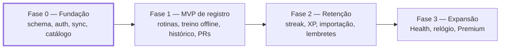

# Visão geral do 1more

> Fonte: `docs/requisitos.txt` (pesquisa e requisitos), `docs/1More-Design-System.txt` e
> `docs/1More-Prototipo-MVP.txt`. Atualizado no T-001 (2026-10-14).

## O que é

Um registrador de treino de academia que **nunca perde uma série**: "rápido como o Strong, motivador como
o Liftoff e funcional mesmo no subsolo da academia sem sinal" (`requisitos.txt`, Visão do produto).
Plataformas: Android e iOS. Idiomas: pt-BR (padrão) e en.

## Por que existe (as dores que ele ataca)

A pesquisa de mercado (`requisitos.txt`, págs. 1–4) mostra que a dor nº 1 dos apps concorrentes é
**confiabilidade**: treino que não salva sem rede ou some depois do sync. Daí as quatro apostas:

| Aposta | Como aparece no produto |
|--------|-------------------------|
| Offline-first de verdade | Cada série é gravada no aparelho no toque; a nuvem é cópia (RN-01, RNF-01, RNF-02) |
| Registro em até 2 toques por série | Valores da sessão anterior pré-preenchidos (RF-31, RF-32, RNF-09) |
| Gamificação opcional e não punitiva | Streak semanal com congelamento, XP; nunca bloqueia nada (RN-14 a RN-17, RF-64) |
| Núcleo gratuito para sempre | Registro, rotinas, histórico e exportação sem paywall (RN-22, RF-51) |

## Personas

| Persona | Perfil | O que precisa |
|---------|--------|---------------|
| Intermediário multimodalidade | Musculação 4–5x/semana + boxe, corrida, basquete | Rotinas próprias, registro rápido, histórico confiável, outras atividades |
| Iniciante | Menos de 6 meses de academia | Programas prontos, demonstração, sugestão de carga, motivação |
| Avançado / powerlifter | Segue programa nomeado (5/3/1, GZCLP) | RPE/RIR, aquecimento, calculadora de anilhas, export |
| Personal trainer | Acompanha alunos | **Fora do MVP** |

## Escopo do MVP

**Dentro:** conta e onboarding, catálogo de exercícios, rotinas, execução de treino offline, timer de
descanso, histórico, PRs, gráficos básicos, streak semanal, XP, sincronização, importação e exportação.

**Fora:** apps de relógio, feed social, IA geradora de treino, módulo de personal trainer, nutrição,
Apple Health / Health Connect (fase 3).

## Roadmap e onde estamos

| Tarefa | Conteúdo | Situação |
|--------|----------|----------|
| T-001 | Fundação: projetos backend e mobile, schema V1, tema, abas | Concluída (backend e mobile aprovados) |
| T-001b | Migrar backend para Spring Boot 4.0.x (ADR-002) | Planejada |
| T-002 | Autenticação (RF-01, RF-05, RNF-11) | Planejada |
| T-003 | Motor de sync `/api/v1/sync/pull` e `/push` (RN-21, RNF-06) | Planejada |
| T-004 | Catálogo de exercícios embarcado (RF-10, RF-11, RN-19) | Planejada |

Fonte: `docs/tasks/BACKLOG.md`.

## Identidade visual em uma frase

"Caderno de treino com graxa de garagem" (direção **Garagem 69**): papel creme, tinta preta, laranja
Hugger para recordes, azul Grabber para série concluída, faixa amarela para treino em andamento. Sem
gradiente, sem sombra difusa, sem emoji. Temas **Papel** (claro, padrão) e **Noite** (escuro). Quatro abas
fixas: **Treinar · Histórico · Progresso · Perfil** (RNF-08). Detalhes em `docs/1More-Design-System.txt`.

## Mapa dos documentos

| Documento | Para quê |
|-----------|----------|
| [arquitetura.md](arquitetura.md) | Componentes, fluxo de dados, sync, o que existe e o que é planejado |
| [como-rodar.md](como-rodar.md) | Ambiente local, portas, variáveis, problemas no Windows |
| [backend.md](backend.md) | API Spring Boot e banco: estrutura, segurança, schema V1, testes |
| [mobile.md](mobile.md) | App RN/Expo: estrutura, tema, componentes, i18n, banco local |
| [../glossario.md](../glossario.md) | Termos do domínio e da arquitetura |
| [CHANGELOG.md](CHANGELOG.md) | O que mudou em cada tarefa |
| [../adr/](../adr/) | Decisões de arquitetura (ADR-001 stack, ADR-002 Spring Boot 4) |
| [../tasks/](../tasks/) | Tarefas com critérios de aceite, backlog e riscos (R-01 a R-11) |

## Perguntas ainda em aberto (decisão do dono do produto)

Do ADR-001: catálogo de exercícios próprio ou licenciado; modelo de receita do Premium; ranks públicos /
social.
